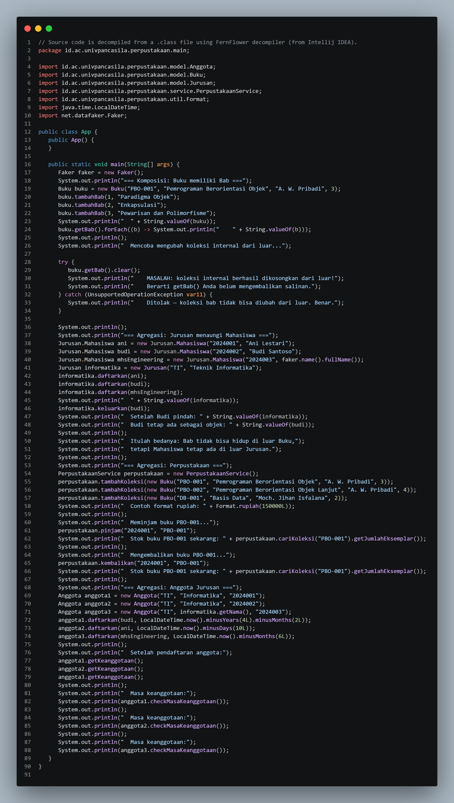
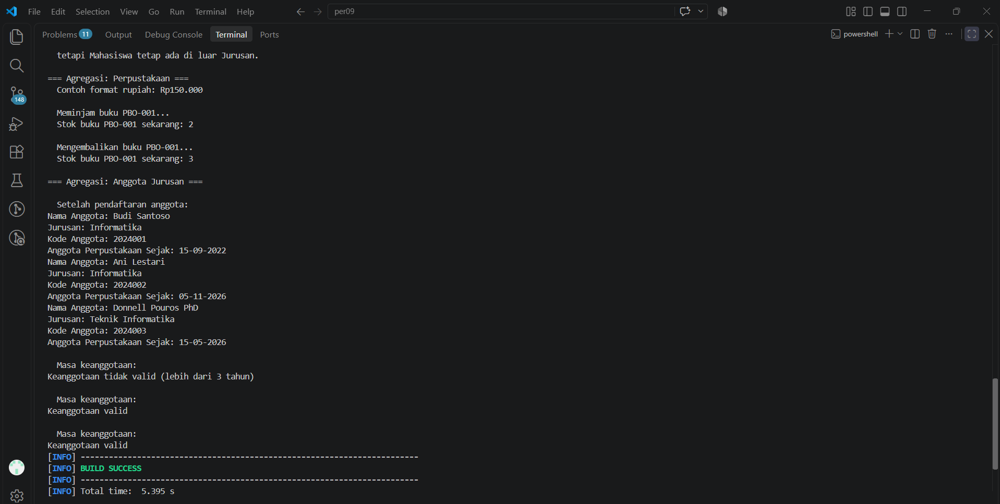

# Laporan Praktikum PBO Sesi 09 — Sistem Perpustakaan

## 1. Tujuan

Menyelesaikan dan merapikan project Sistem Perpustakaan pada sisi Java (Maven) dan PHP (Composer), termasuk konfigurasi dependency, autoload, komposisi, agregasi, dan proses peminjaman buku.

## 2. Pengerjaan Java (Maven)

File utama: `perpustakaan/`

Pekerjaan yang diselesaikan:
- Mengatur `pom.xml` dengan `groupId`, `artifactId`, dan `version`.
- Menyesuaikan target kompilasi ke Java 21 agar sesuai dengan JDK 21 yang digunakan.
- Menambahkan dependency Datafaker yang dipakai oleh `App.java`.
- Mengatur `maven-compiler-plugin` satu kali saja agar tidak terjadi deklarasi plugin ganda.
- Mengatur `exec-maven-plugin` agar menjalankan class `id.ac.univpancasila.perpustakaan.main.App`.
- Menyelesaikan validasi komposisi pada `Buku`: jumlah eksemplar tidak boleh negatif, bab dibuat oleh Buku, getter mengembalikan salinan yang tidak dapat diubah, dan stok tidak boleh berkurang jika habis.
- Menyelesaikan agregasi pada `Jurusan`: mahasiswa berasal dari luar, data null/duplikat ditolak, dan getter mengembalikan salinan yang tidak dapat diubah.
- Memperbaiki tipe data mahasiswa pada `Anggota` agar menggunakan `Jurusan.Mahasiswa`, serta menambahkan validasi tanggal dan status pendaftaran.

### Perintah menjalankan Java

Buka terminal di folder `perpustakaan` (folder yang berisi `pom.xml`), lalu jalankan:

```bash
mvn clean compile
mvn exec:java
```

## 3. Pengerjaan PHP (Composer)

Folder utama: `php/`

Pekerjaan yang diselesaikan/diperiksa:
- Menggunakan pemetaan PSR-4 `Perpustakaan\\` ke folder `src/`.
- Menyiapkan pemetaan PSR-4 untuk namespace pengujian `Perpustakaan\\Tests\\` ke folder `tests/`.
- Memakai dependency `nesbot/carbon` untuk pengolahan tanggal.
- Memakai `vendor/autoload.php` sebagai autoloader di `main.php`.
- Memeriksa sintaks seluruh file PHP.
- Memeriksa alur komposisi Buku-Bab, agregasi Jurusan-Mahasiswa, peminjaman/pengembalian buku, serta masa keanggotaan.

### Perintah menjalankan PHP

Buka terminal di folder `php` (folder yang berisi `composer.json`), lalu jalankan:

```bash
composer install
composer validate
php main.php
```

Project PHP ini menetapkan PHP `^8.5.12` pada `composer.json`. Pastikan versi PHP pada terminal memenuhi persyaratan tersebut sebelum menjalankan `composer install`.

## 4. Hasil pengujian

### Java





### PHP


## 5. Catatan menjalankan project

- Jalankan perintah Maven dari folder `perpustakaan`, bukan dari folder induk `per09`.
- Jalankan perintah Composer dari folder `php`.
- Jangan menghapus `pom.xml`, `composer.json`, atau `composer.lock`.
- Folder `target/` dan `vendor/` akan dibuat otomatis saat proses build/install dan tidak perlu disertakan sebelum dependency dipasang.

## 6. Kesimpulan

Konfigurasi project Java Maven dan PHP Composer telah dirapikan. Implementasi komposisi, agregasi, pengelolaan koleksi buku, peminjaman, pengembalian, dan keanggotaan telah diperiksa melalui uji lokal. Dependency asli Maven dan Composer akan dipasang pada komputer pengguna melalui perintah yang tercantum di laporan.
