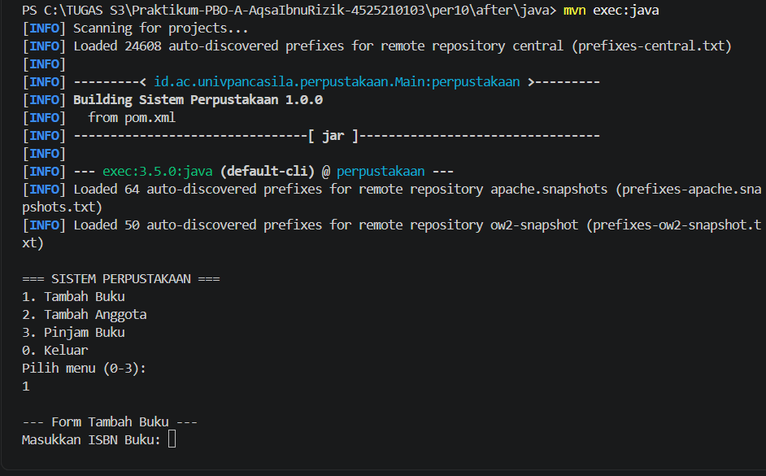
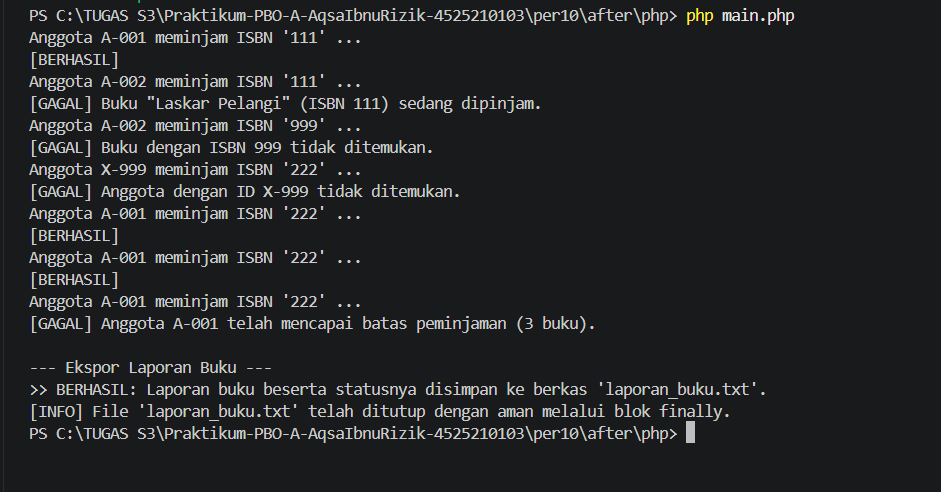

# Laporan Praktikum PBO - Pertemuan 10
NAMA : Aqsa Ibnu Rizik
Npm :4525210103

## Sistem Perpustakaan

Praktikum ini membuat program sederhana untuk mengelola data buku dan anggota perpustakaan. Program dibuat menggunakan Java dan PHP. Materi yang digunakan adalah exception handling dan pemrograman defensif.

## 1. Hasil Program Java

Program Java menampilkan menu untuk menambah buku, menambah anggota, meminjam buku, dan keluar dari program.

**Hasil output Java:**

## 2. Hasil Program PHP

Program PHP menjalankan beberapa percobaan peminjaman buku. Hasilnya menampilkan transaksi yang berhasil maupun gagal, misalnya karena buku sedang dipinjam, ISBN tidak ditemukan, anggota tidak terdaftar, atau batas peminjaman tercapai.

Program juga membuat file `laporan_buku.txt` yang berisi daftar buku, jumlah stok, dan status ketersediaan.

**Hasil output PHP:**

## 3. Kesimpulan

Dari praktikum ini, exception handling digunakan untuk menangani kesalahan saat proses peminjaman buku. Program dapat menampilkan alasan ketika transaksi gagal, sehingga pengguna lebih mudah mengetahui masalah yang terjadi. Implementasi dilakukan pada Java dan PHP dengan hasil output masing-masing seperti pada gambar di atas.
